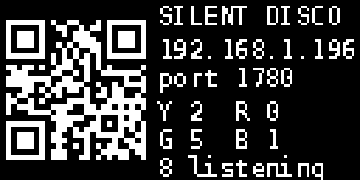

# Server box face: LED ring + OLED

The front of the Dial box. A 16-pixel WS2812 ring split into four quadrants,
one per colour channel, and a 0.96" SSD1306 OLED showing the join QR code and
listener counts. Driven straight from the Pi 3B's header by `face.py`.

```
      Yellow                 ┌────────────────┐
    ◜  ◝  ◝                  │ ▛▀▀▜  SILENT   │
  Blue    Red   ring         │ ▌QR▐  DISCO    │   OLED
    ◟  ◞  ◞                  │ ▙▄▄▟  192...   │
      Green                  │       Y 2  R 0 │
                             └────────────────┘
```

Each quadrant glows dimly in its colour all the time. One pixel per listener
lights up bright, so a glance tells you how the room is split. More than four
on a channel and the quadrant pulses.

## Wiring

Pi 3B header, looking at the board with the USB ports to the right. Pin 1 is
the corner nearest the microSD slot.

| Part | Wire | Pi pin | GPIO / rail |
|---|---|---|---|
| Ring | VCC / 5V | **2** | 5 V |
| Ring | GND | **6** | GND |
| Ring | DIN (data in) | **12** | GPIO 18, PWM0 |
| OLED | VCC | **1** | 3.3 V |
| OLED | GND | **9** | GND |
| OLED | SDA | **3** | GPIO 2, I2C SDA |
| OLED | SCL | **5** | GPIO 3, I2C SCL |

Notes on the ring:

- Put a **330 Ω resistor** in series with DIN, close to the ring. You have a
  300 Ω in the puck parts list; that's fine too.
- A **100 to 1000 µF capacitor** across the ring's 5 V and GND stops the first
  pixel glitching when it powers up. Not required at 16 pixels, nice to have.
- The Pi drives DIN at 3.3 V and the ring expects 5 V logic. With 16 pixels on
  a short lead this works in practice. If pixels flicker or show wrong
  colours, add a 74AHCT125 level shifter or run DIN through one spare pixel
  powered from 3.3 V (the "sacrificial pixel" trick).
- Brightness is capped at 96/255 in the service. Sixteen pixels at full white
  is about 1 A, which the Pi's 5 V pin cannot give; at 96 and in colours it
  is under 300 mA.
- The ring uses the Pi's PWM, which the onboard 3.5 mm audio also uses. The
  installer turns the onboard audio off (`dtparam=audio=off`). Snapcast
  does not use it, so nothing is lost.

Notes on the OLED:

- Most 0.96" modules are address `0x3C`. `i2cdetect -y 1` shows it. If yours
  says `3d`, set `FACE_OLED_ADDR=0x3D` in `/etc/default/silentdisco-face`.
- The four pins are usually GND, VCC, SCL, SDA in that order, but check the
  silkscreen on your module; some swap GND and VCC.

## Install

```bash
cd ~/SilentDisco/box && sudo ./install.sh
```

Creates a Python venv at `/opt/silentdisco-face`, installs the ring and OLED
libraries, enables I2C, disables onboard audio, and starts
`silentdisco-face.service`. Reboot once after the first install so the audio
driver releases the PWM.

Check it:

```bash
i2cdetect -y 1
```

```bash
journalctl -fu silentdisco-face
```

Test without hardware, or before wiring:

```bash
sudo /opt/silentdisco-face/bin/python /opt/silentdisco-face/face.py --dry-run
```

## Tuning

`/etc/default/silentdisco-face`:

| Variable | Default | What |
|---|---|---|
| `FACE_LED_OFFSET` | 0 | Rotate the quadrants so Yellow sits where you want it once the ring is mounted |
| `FACE_LED_BRIGHT` | 96 | 0 to 255 |
| `FACE_LED_COUNT` | 16 | Use 8 with the small ring, two pixels per channel |
| `FACE_OLED_ADDR` | 0x3C | I2C address |
| `FACE_DIM` | 0.06 | Idle glow of an empty quadrant, as a fraction of full colour |
| `FACE_PURE` | 1 | 1 for saturated primaries, 0 for softer mixes that diffuse nicer |

Restart after changes:

```bash
sudo systemctl restart silentdisco-face
```

## What the OLED shows



Left: the join QR, 2 px per module. Right: title, the IP and port as text for
anyone whose camera won't scan, and the live count per colour. The URL is
re-checked every 30 s in case DHCP moves the Pi.
