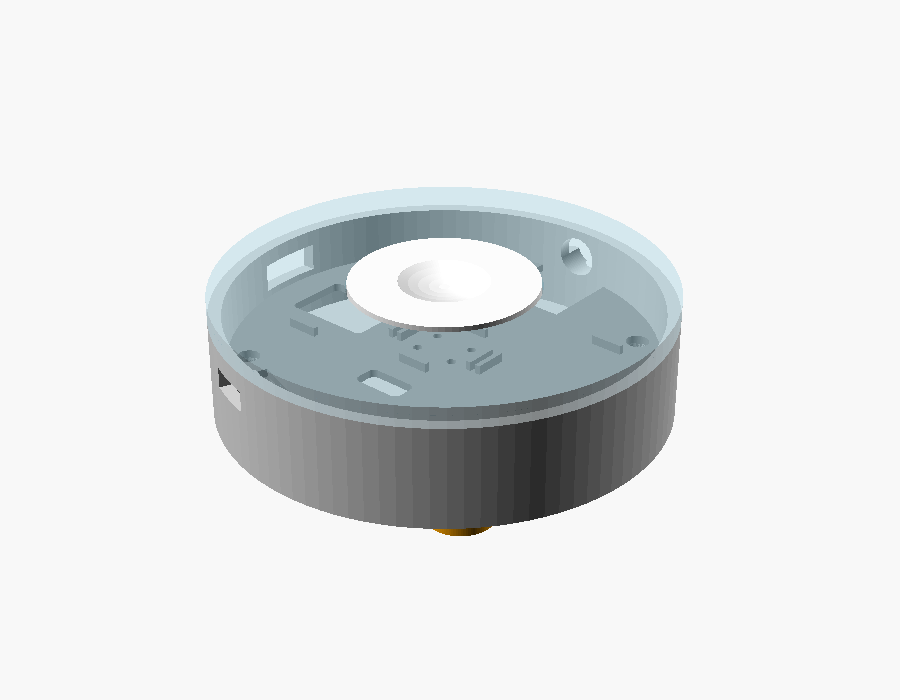
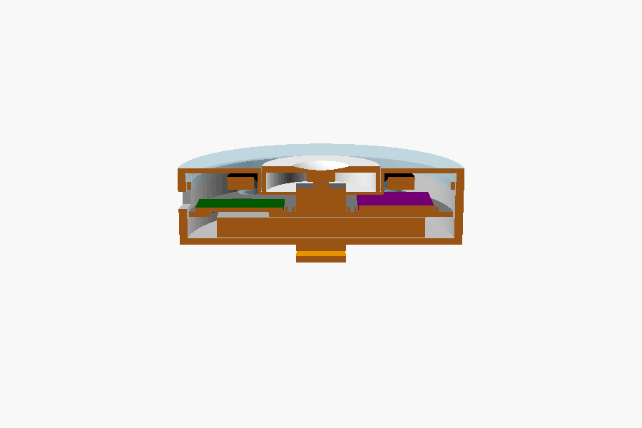
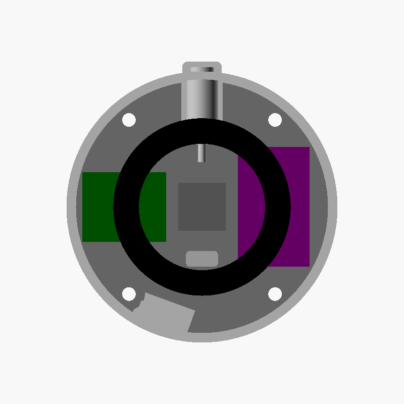
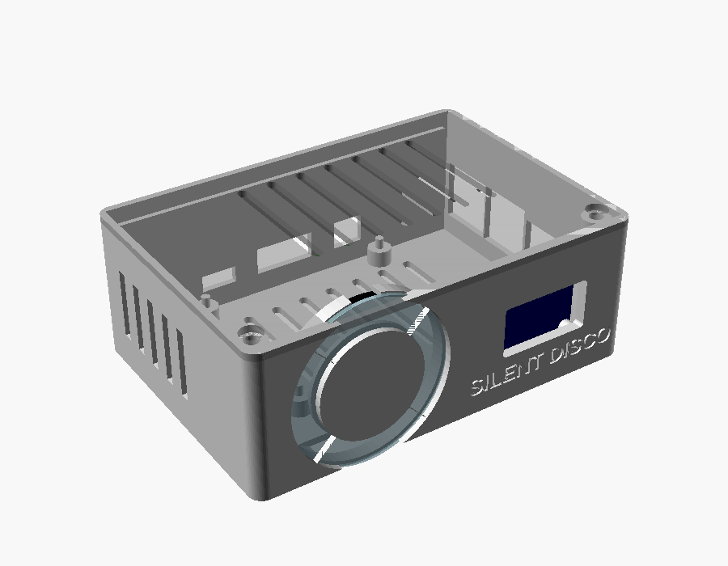
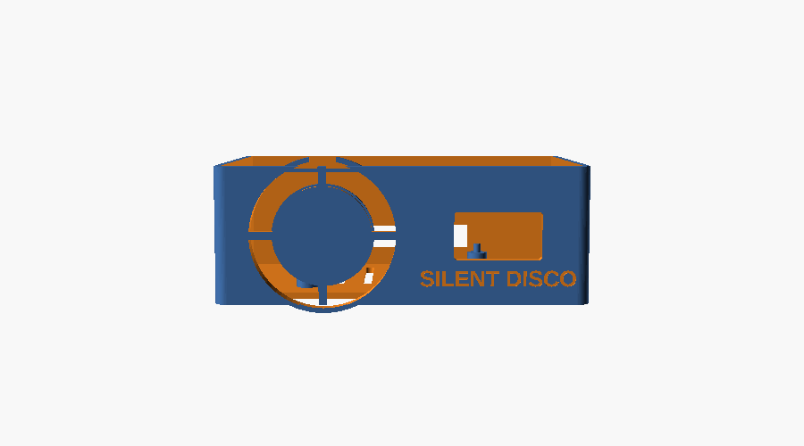

# Printed parts: Halo puck and Dial server box

Parametric OpenSCAD models. Every dimension is a named variable at the top of
each file; change it, re-render, print. OpenSCAD was chosen over Blender
because these are mechanical parts with fits and tolerances, and a text model
with named numbers is easier to tune after the first test print than a mesh.

```
hardware/
  halo/halo.scad      puck: base, tray, lid (clear), cap, clip, fit coupon
  dial/dial.scad      server box: base, lid, window (clear)
  previews/           renders of the current state
```

Render parts from the command line (or open the file in OpenSCAD and set
`part` at the top):

```bash
cd hardware/halo
for p in base tray lid cap clip coupon; do openscad -D "part=\"$p\"" -o "halo-$p.stl" halo.scad; done
```

```bash
cd hardware/dial
for p in base lid window; do openscad -D "part=\"$p\"" -o "dial-$p.stl" dial.scad; done
```

`part="assembly"` shows everything together with the components drawn in.

## Halo puck





Ø 68 × 19 mm. Six printed parts:

| Part | Material | Orientation | Notes |
|---|---|---|---|
| `coupon` | whatever | flat | **Print first.** Three cap-in-collar clearances and two snap lips. Pick what slides freely and set `fit` and `snap_fit` to match. |
| `base` | PLA or PETG, any colour | open side up | Battery ribs, four screw bosses, USB-C slot, jack hole, power-switch slot, lanyard tab. |
| `tray` | same | flat | Carries the XIAO, the DAC and the switch between small edge stops. Notched under the jack and the power switch. |
| `lid` | **clear PETG** | top face down | Diffuser, cap collar, ring cradle ribs, and the four posts that hold the M3 inserts. 2 perimeters, 0 % infill, 1.2 mm top so it scatters light. |
| `cap` | white or clear | top face down | Ø 28 floating button with a flange under the collar. Rendered already flipped. |
| `clip` | **PETG** | arm up | Pocket clip caught under the two rear floor screws. Optional: `with_clip`. |

Lanyard: a tab with a Ø 3.4 mm tangential hole at 12 o'clock, directly below
the jack and flush with the floor, so the puck hangs face out with the cable
going up. Optional: `with_lanyard`.

How it goes together, bottom to top:

1. Melt four M3 inserts into the **lid posts** (they face down).
2. Battery into the base, foam tape underneath, leads toward the centre notch.
3. Solder the DAC to the XIAO (BCK, LCK, DIN, GND; SCK to GND; DAC VIN to the battery rail, not 3V3), the
   switch to a GPIO, the ring to BAT+, GND and a GPIO through 300 Ω, the
   battery to the XIAO's BAT pads through the slide switch, and the panel
   jack to the DAC's L, R and GND pads. Drop the boards and switch onto the tray.
4. Tray onto the bosses, USB-C through the wall slot. Screw the panel jack
   into the wall with its lugs turned sideways (they end beside the switch);
   glue the slide switch between its two posts.
5. Ring onto the four ribs under the lid. Cap into the collar from below,
   flange first. Lower the lid; the posts land on the tray.
6. Four M3 × 14 screws up from underneath. The clip plate goes under the two
   rear screws if you want it.

The shell is sized for the **XIAO ESP32-S3** (21 × 17.5 mm). The D1 mini32 on
your bench is 39 × 31 mm and does not fit beside the switch; use it on the
breadboard to prove the firmware, then move to the XIAO or a Lolin32 Lite
(change `xiao` and `xiao_pos`).

Things the first print will tell you: whether the cap slides without rattling
(`fit`), whether the lid lip is snug (`snap_fit`), and whether the ring's wire
tails clear the posts.

## Dial server box




114 × 80 × 42 mm. Three printed parts:

| Part | Material | Orientation | Notes |
|---|---|---|---|
| `base` | any | open side up | Pi on four 2.5 mm pegs (set `pi_mount="screw"` for M2.5 holes). Ports out the right and back. Ring cradle and OLED posts on the inside of the front wall. Vents in the floor and left wall. |
| `lid` | any | printed upside down, already flipped | Two hooks slide under the back wall lip, two M3 screws at the front corners into inserts. Vents over the Pi. |
| `window` | **clear PETG** | flat | Ø 47 disc that drops into the recess behind the four quadrant windows. |

Front face: four arc windows around a 16-pixel ring, one colour each, ribs on
the axes so a quadrant lights without bleeding into the next; the 0.96" OLED
in a 26 × 14 window; "SILENT DISCO" engraved under it (`label`).

Before printing, check two numbers against your parts: `oled_holes` (hole
pitch on your OLED module, commonly 23.5 mm) and `oled_glass_offset` (the
glass sits below the PCB centre because the pins are at the top).

Assembly: inserts into the two front bosses; Pi onto the pegs; ring into the
cradle behind the window, a dab of hot glue; OLED onto its posts with M2
screws; wires to the Pi header (ring data on GPIO 18, OLED on I2C); lid hooks
in at the back, two M3 × 8 at the front.

## Print settings that matter

- 0.2 mm layers, 3 perimeters for the bases, 2 for the clear parts.
- Clear PETG: 0 % infill, slow (30 mm/s), slightly hot. Sand with 400 then
  1000 grit if you want an even glow rather than a layered one.
- The lid lips and the lid hooks are the only overhangs; no supports needed.
- Heat-set inserts: M3 × 4 × 5 mm into Ø 4.0 holes at about 230 °C.
