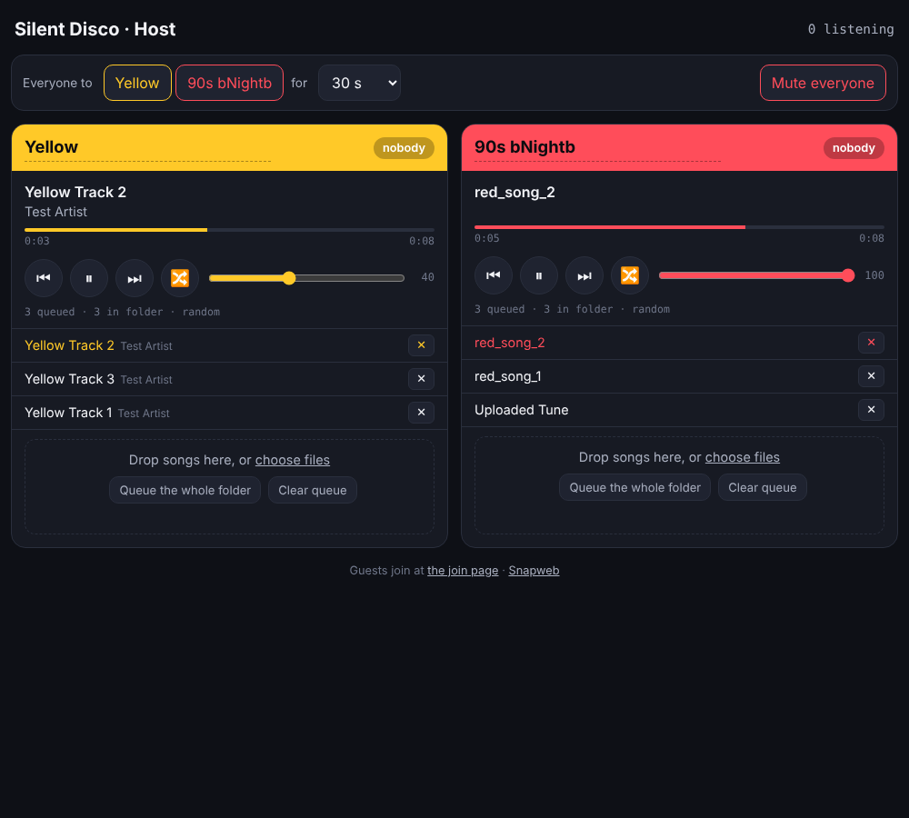

# Host controls

The page for whoever runs the party: `http://<pi>:1780/host/`, behind a PIN.



Per colour: now playing with progress, play, pause, skip, previous, shuffle,
volume, the queue (tap a row to jump, ✕ to remove from the queue, 🗑 to
delete the file from the folder), a Folder view of every file with queue and
delete buttons, drag-and-drop uploads straight from a phone or laptop,
"queue the whole folder", clear. Rename a
channel for the night by tapping its name. Across the room: live listener
counts, "Everyone to Red for 30 s" with automatic release, mute everyone.

## What changes under the hood

Each colour is now an **MPD** instance (Music Player Daemon) writing into the
same FIFO Snapcast reads. MPD brings play, pause, skip, queue and library for
free and is the standard pairing with Snapcast. The ffmpeg loopers from the
first install are disabled; the music folders are the same, so nothing has
to be copied.

`host.py` is a small standard-library Python service on port 1790 that talks
to the four MPDs and to Snapcast's JSON-RPC, and that the host page calls.
It also keeps every channel playing: a channel with files but an empty queue
gets filled and started, at boot and once a minute after.

```
web/host/index.html  ──HTTP :1790──▶  host.py  ──MPD protocol──▶  mpd@yellow  ──FIFO──▶  snapserver
                                        │                         mpd@red
                                        └──JSON-RPC :1780──▶  snapserver (listeners, takeover, mute)
```

## Install

After the server installer:

```bash
cd ~/SilentDisco/host && sudo ./install.sh
```

Prints the PIN. Change it from the host page ("Change PIN" in the footer:
current, new, confirm). It is stored in `/var/lib/silentdisco/host/pin`; if you
ever lose it, read or overwrite that file on the Pi and restart
`silentdisco-host`.

## Operating

```bash
journalctl -fu silentdisco-host -u 'silentdisco-mpd@*'
```

```bash
mpc -p 6601 status      # yellow  (6602 red, 6603 green, 6604 blue)
```

Uploads land in `/var/lib/silentdisco/music/<colour>/` like any other file.
Loudness: MPD applies ReplayGain when files carry tags. Untagged files play
at their own level; the per-channel volume slider is the fix at the party.

## API

All on port 1790. Everything but the first needs the PIN as an `X-Pin`
header.

| Call | Does |
|---|---|
| `GET /api/channels` | ids, display names, colours (public; the join page uses it) |
| `GET /api/state` | everything the page shows |
| `POST /api/channel/<id>/cmd` | `{"cmd": "play"\|"pause"\|"next"\|"prev"\|"shuffle"\|"clear"\|"fill"\|"volume","value":N\|"random","value":0/1\|"remove","id":N\|"jump","id":N\|"add","file":"…"}` |
| `PUT /api/channel/<id>/files?name=f.mp3` | body is the file; indexed and queued |
| `DELETE /api/channel/<id>/files?name=f.mp3` | removes the file and any queue entries for it |
| `GET /api/channel/<id>/library` | file list |
| `POST /api/channel/<id>/name` | `{"name": "…"}` |
| `POST /api/takeover` | `{"target": "<id>", "seconds": 30}` |
| `POST /api/release` | |
| `POST /api/mute` | `{"muted": true}` |
| `POST /api/pin` | `{"old": "1234", "new": "5678"}`, 4 to 8 digits |
| `GET /api/wifi` | mode, ssid, hotspot password, address, boot setting |
| `POST /api/wifi` | `{"mode": "ap"}` / `{"mode": "client"}` / `{"boot": "on"}` |
